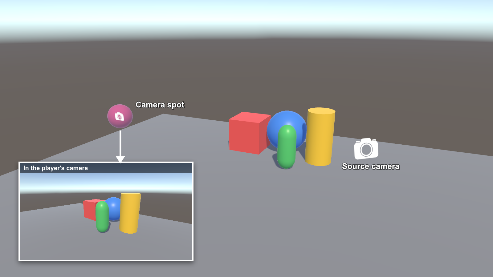
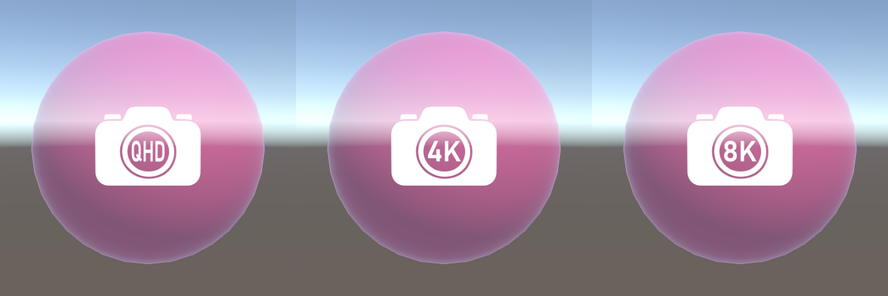
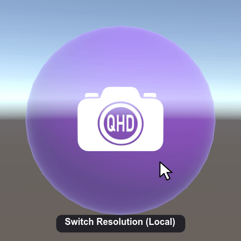

# VRC Camera Spot

A VRChat world camera spot: players who put their camera in the spot see a fixed, pre-framed view.

## Installation

1. Open [Puetsua's VPM](https://vrchat.puetsua.net/vpm/) and press **Add to VCC**.
   - Or add it by hand: in VCC, go to **Settings → Packages → Add Repository** and paste `https://vrchat.puetsua.net/vpm/vpm.json`.
2. In VCC, open your world project under **Manage Project** and add **VRC Camera Spot**.

## Quick Start

1. In the Project window, open **Packages → VRC Camera Spot → Prefabs** and drag one prefab into your scene:
   - `VRCCameraSpot_QHD`, `VRCCameraSpot_4K` or `VRCCameraSpot_8K`: fixed resolution.

     

   - `VRCCameraSpot_Switchable`: players click the spot ("Switch Resolution (Local)") to switch between QHD, 4K and 8K. The switch is local, so it only affects that player.

     

2. Move `SourceCamera_MoveMe` to the view you want to show.
3. Move `SpotOverlayQuad_Internal` and `VisibleGuideSphere` to the place where players should hold their camera.
4. In game, players move their camera into the sphere to see the view. In VR that's the handheld camera; on desktop it's the player's view.
